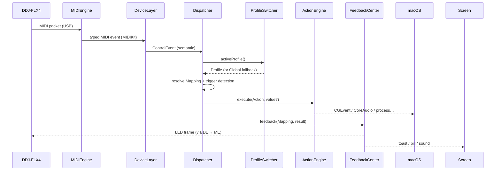

# DeckPad — Architecture

Single macOS app target (SwiftUI lifecycle), organized as decoupled modules communicating through typed events and observable state. Architectural decisions are recorded in [99-decisions.md](99-decisions.md); the single-app choice is [ADR-001](99-decisions.md#adr-001-single-app-architecture).

## 1. Module map

```
┌──────────────────────────────────────────────────────────────────┐
│  UI Layer (SwiftUI)                                              │
│  ControllerCanvas · MappingEditor · SettingsView · MIDIMonitor   │
│  MenuBarExtra · OnboardingFlow                                   │
└───────────────▲──────────────────────────────┬───────────────────┘
                │ observes (AppState)          │ edits
┌───────────────┴───────────┐      ┌───────────▼───────────────────┐
│  ProfileSwitcher          │      │  MappingStore                 │
│  frontmost-app watcher →  │◀────▶│  profiles, mappings,          │
│  active profile           │      │  JSON persistence             │
└───────────────▲───────────┘      └───────────▲───────────────────┘
                │ resolves mapping             │ reads
┌───────────────┴──────────────────────────────┴───────────────────┐
│  Dispatcher (the hub)                                            │
│  ControlEvent + active profile → resolved Mapping → execute      │
└──────▲──────────────────────────┬──────────────────┬─────────────┘
       │ ControlEvent             │ Action           │ FeedbackEvent
┌──────┴────────────┐   ┌─────────▼────────┐   ┌─────▼─────────────┐
│  DeviceLayer      │   │  ActionEngine    │   │  FeedbackCenter   │
│  DDJFLX4Descriptor│   │  keystrokes, CC  │   │  toast, pill,     │
│  raw MIDI ↔       │   │  audio, scripts  │   │  sound, LED-out   │
│  semantic controls│   └─────────┬────────┘   └─────┬─────────────┘
└──────▲────────────┘   ┌─────────▼────────┐         │ LED frames
┌──────┴────────────┐   │ PermissionsMgr   │         │
│  MIDIEngine       │   │ AX trust, automa-│◀────────┘ (via MIDIEngine)
│  CoreMIDI/MIDIKit │   │ tion, login item │
│  in/out, hot-plug │   └──────────────────┘
└───────────────────┘        ServiceController (lifecycle, activation
                             policy, login item, coexistence pause)
```

### Module responsibilities

| Module | One-line contract | Depends on |
|---|---|---|
| **MIDIEngine** | Owns CoreMIDI (via MIDIKit). Emits raw MIDI events + connection state; accepts outbound MIDI (LEDs). Handles discovery and hot-plug (FR-1, FR-2, FR-4, FR-5). | MIDIKit |
| **DeviceLayer** | `DeviceDescriptor` protocol + `DDJFLX4Descriptor`. Translates raw MIDI → `ControlEvent` (semantic, typed) and LED intents → raw MIDI. Assembles 14-bit CC pairs, tracks SHIFT layer and jog-touch state (FR-3, FR-12, FR-14). | MIDIEngine |
| **Dispatcher** | The hub: for each `ControlEvent`, asks ProfileSwitcher for the active profile, resolves the mapping (with Global fallthrough), runs trigger detection (double-tap/hold timers), forwards to ActionEngine and FeedbackCenter. | DeviceLayer, MappingStore, ProfileSwitcher |
| **MappingStore** | Source of truth for profiles/mappings. Codable JSON in Application Support; atomic writes; import/export (FR-20, FR-23, NFR-7). | Foundation only |
| **ProfileSwitcher** | Watches `NSWorkspace.didActivateApplicationNotification`; resolves active profile incl. manual pin and DJ-software coexistence pause (FR-21, FR-22, FR-7). | MappingStore |
| **ActionEngine** | Executes `Action` values: CGEvent keystrokes/scroll, NX system keys, CoreAudio volume, DisplayServices brightness, `shortcuts run`, shell, AppleScript (FR-30, FR-31). One executor type per action kind. | PermissionsManager |
| **FeedbackCenter** | Renders feedback per config matrix: notch toast + pill (NSPanel overlays), sound, LED intents back through DeviceLayer (FR-40, FR-41). | DeviceLayer |
| **PermissionsManager** | Central truth for Accessibility/Automation/login-item status; publishes changes; deep-links to System Settings panes. | AppKit |
| **ServiceController** | App lifecycle: activation policy (regular ↔ accessory), login item registration, single-instance guard, coexistence pause (FR-50, FR-51, FR-32). | PermissionsManager |
| **UI layer** | SwiftUI views observing `AppState`; edits go through MappingStore APIs only. | all above via AppState |

## 2. Core types (shared vocabulary)

These names are canonical across docs, code, and task files.

```swift
/// Stable identity for a physical control, defined by the device descriptor.
/// Examples: deck1.play, deck1.pad5, deck2.jog, mixer.crossfader, browser.encoder
struct ControlID: Hashable, Codable { let rawValue: String }

enum ControlKind { case button, pad, fader, knob, encoder, jog, slider }

/// Semantic event out of DeviceLayer — the rest of the app never sees MIDI.
enum ControlEvent {
    case pressed(ControlID, shifted: Bool)
    case released(ControlID, shifted: Bool)
    case value(ControlID, Double, shifted: Bool)        // absolute 0.0…1.0 (14-bit aware)
    case relative(ControlID, ticks: Int, touched: Bool, shifted: Bool)  // jogs/encoders
}

enum Trigger: Codable { case press, release, doubleTap, hold(ms: Int), toggle, continuous, relative }

/// See 06-actions-catalog.md for the full Action enum surface.
struct Mapping: Codable, Identifiable {
    var id: UUID
    var control: ControlID
    var shiftLayer: Bool           // false = base layer, true = SHIFT held
    var trigger: Trigger
    var action: Action
    var releaseAction: Action?     // fired on release after a .hold fires (06 §9)
    var secondaryAction: Action?   // the alternate action for .toggle (06 §9)
    var jumpImmediately: Bool      // continuous: bypass soft-takeover pickup (06 §7)
    var feedback: FeedbackOverride // per-channel inherit/on/off
    var label: String              // user-facing name shown in canvas + toast
}

struct Profile: Codable {
    var id: UUID
    var name: String
    var appBundleIDs: [String]     // empty = Global profile
    var mappings: [Mapping]
    var schemaVersion: Int
}
```

## 3. Data flow



Profile switching runs on a parallel path: `NSWorkspace` activation notification → ProfileSwitcher recomputes active profile → publishes to Dispatcher and UI.

## 4. Threading model

| Context | What runs there | Why |
|---|---|---|
| MIDI receive (CoreMIDI thread) | MIDIEngine callback → hand off to MainActor | Never block; decode is allocation-light |
| MainActor | Dispatcher (decode, trigger detection, resolution, ActionEngine fast path), all UI, ProfileSwitcher | v1 choice per [ADR-008](99-decisions.md#adr-008-dispatcher-runs-on-the-mainactor-v1) — measured dispatch cost is µs-scale; a dedicated serial queue remains a profiled optimization |
| Background (`.utility`) | Shell/AppleScript/Shortcut executors | Unbounded latency must not block the hub (FR-31) |

Continuous-control events are **coalesced** on DispatcherQueue: only the latest value per control per 8 ms tick reaches ActionEngine/FeedbackCenter (NFR-1, FR-41).

## 5. Persistence

- Location: `~/Library/Application Support/DeckPad/`
  - `profiles/<uuid>.deckpad.json` — one file per profile
  - `settings.json` — app settings (feedback defaults, coexistence, onboarding state)
- Writes are atomic (temp file + rename); saves debounced 500 ms after last edit.
- `schemaVersion` on every file; loader migrates or refuses politely (never destroys user data).
- The scaffold's SwiftData stack is removed in M0 ([ADR-005](99-decisions.md#adr-005-codable-json-persistence-not-swiftdata)).

## 6. Error handling policy

| Failure | Behavior |
|---|---|
| MIDI parse/unknown message | Log (os.Logger, `midi` category), drop. Never crash (NFR-3). |
| Device disconnect | State → `.disconnected`; menu bar icon dims; auto-resume on reconnect (FR-4). |
| Accessibility revoked at runtime | ActionEngine detects failed post, sets PermissionsManager flag; menu bar shows warning badge; toast explains once (not per keypress). |
| Shell/script non-zero exit | Feedback shows failure variant; stderr captured to log; never blocks the hub. |
| Profile JSON unreadable | Load remaining profiles; quarantine bad file as `.broken`; surface non-modal alert. |
| Two DeckPad instances | Second instance activates the first and exits (ServiceController single-instance guard). |

## 7. Extensibility seams (deliberate, but dormant in v1)

- **Other controllers:** everything device-specific lives behind `DeviceDescriptor`. A future DDJ-400/REV1 descriptor is a new file + canvas layout, zero core changes.
- **Split daemon:** if the accessory-app model proves insufficient, Dispatcher-and-below can move into a LaunchAgent with XPC to the UI. Deferred — see [ADR-001](99-decisions.md#adr-001-single-app-architecture).
- **Macro sequences:** `Action` is a value type; a future `.sequence([Action])` case slots into ActionEngine without schema breakage.
