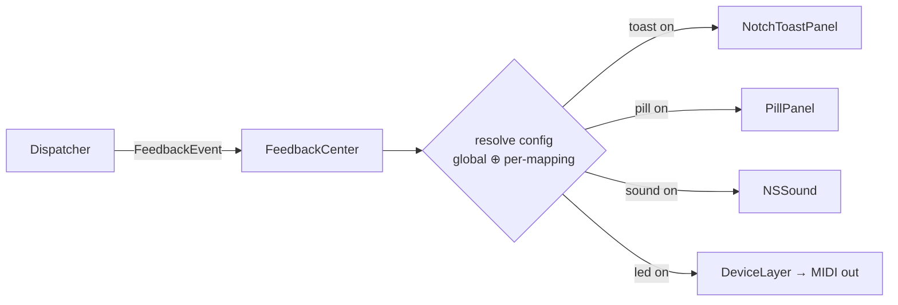

# DeckPad — Feedback System

How the user learns an action fired (FR-40, FR-41). Four channels, all optional, owned by **FeedbackCenter** ([02-architecture.md](02-architecture.md)). Overlay panels are custom `NSPanel`s, not Notification Center ([ADR-006](99-decisions.md#adr-006-feedback-overlays-are-custom-nspanels-not-notification-center)).

## 1. Channels

### 1.1 Notch toast

A compact glass capsule that appears to slide out from under the notch.

- **Geometry:** on notched displays, centered under the camera housing, width ≈ notch width + 40 pt, detected via `NSScreen.safeAreaInsets` / auxiliary top areas. On non-notch displays: top-center, 8 pt below the menu bar.
- **Panel:** non-activating `NSPanel`, `.statusBar` window level, ignores mouse, joins all Spaces (`.canJoinAllSpaces`), excluded from Mission Control/screenshot selection where possible.
- **Content (discrete):** action SF Symbol + mapping label + optional `KeyCapView` combo (e.g. ⚡ *Run tests* `⌘U`). Failure variant: `state.danger` icon + "failed" suffix.
- **Timing:** spring in 0.3 s → hold 1.2 s → fade 0.25 s. New toast while visible: content crossfades in place (no stacking).
- **Material:** `glassEffect(.clear)` + `glass.tint`; dark-appearance-forced so it reads on any wallpaper.

### 1.2 Floating pill

A wider capsule at bottom-center (Raycast-toast position), above the Dock.

- **Geometry:** bottom-center, 24 pt above Dock top (or screen bottom if Dock hidden), max width 380 pt.
- **Discrete variant:** same content as toast — for users who prefer bottom placement.
- **Continuous variant (FR-41):** icon + `ValueBar` + numeric readout (e.g. 🔆 ▓▓▓▓░░ 62%). Direct-drive while the control moves; lingers 800 ms after the last tick then fades. One pill per continuous control; concurrent controls stack (max 3, oldest drops).
- Same panel behavior/material as the toast.

### 1.3 Sound cue

- `NSSound` playing a system sound (picker: Tink, Pop, Glass, …) or a bundled DeckPad click; volume slider (independent of system volume where the API allows).
- **Rate limit:** ≥ 150 ms between plays; continuous controls never trigger sounds (only their engage/release when pickup mode catches — a single soft tick).

### 1.4 Controller LED (FR-5)

Closes the loop on the hardware itself. Depends on the M1 LED capture ([03-device-ddj-flx4.md §4](03-device-ddj-flx4.md#4-led-output-protocol-capture-pending)).

- **Ambient state:** mapped pads lit dim in a per-category color (from the captured palette); unmapped controls dark. Refreshed on profile switch — the hardware shows which pads do something *in the current profile*.
- **Trigger flash:** actuated control's LED flashes bright 150 ms, then returns to ambient.
- **Suspend/pause:** all LEDs off (visual confirmation DeckPad is inert).
- **Budget:** LED frames coalesced ≤ 30 fps; full-surface refresh is a single batched frame (rate-limit findings from M1 apply).

## 2. Event → feedback pipeline

`FeedbackEvent` carries: mapping label, action kind (icon + template), result (success/failure), value (for continuous), origin control (for LED). All resolution and rendering on MainActor except LED frames (DispatcherQueue).

## 3. Configuration matrix

**Global defaults** (Settings → Feedback): per channel — off / discrete only / discrete + continuous (toast has no continuous mode; LED ambient is a separate toggle).

| Channel | Default |
|---|---|
| Notch toast | on (discrete) |
| Floating pill | continuous only |
| Sound | off |
| LED ambient | on |
| LED trigger flash | on |

**Per-mapping override** (inspector, FR-40): each channel = inherit / force on / force off. Stored in `Mapping.feedback` (`FeedbackOverride`).

**Global quiet switches:**
- Suspend DeckPad ⇒ no feedback at all.
- "Hide overlays while screen is shared" (Settings toggle, default on) — investigation task in M5 for the macOS 26 screen-capture-detection API; ships only if reliable.

## 4. Content templates

Default toast/pill text per action category (used unless the user sets a mapping `label`):

| Action | Template |
|---|---|
| Keystroke | `⌨️ <keycaps>` |
| Text snippet | `⌨️ Typed "<first 20 chars>…"` |
| Media/system key | icon only (▶️ 🔊 🔆 …) + step direction |
| App action | app icon + "Opened <App>" |
| Shortcut / shell / AppleScript | `⚡ <name or first token>` → success ✓ / failure ✕ (async result updates the visible toast) |
| Internal | `● <description>` (e.g. "Profile: Xcode") |
| Profile auto-switch | `⇄ <profile name>` (its own toggle in Settings → Feedback) |
| Continuous | icon + ValueBar + % (pill only) |

## 5. Multi-display policy

- Toast + pill render on the **screen with the frontmost app's key window** (that's where the user is looking); fallback: screen with mouse pointer.
- Only ever one instance of each panel — panels move between displays rather than duplicate.
- Notch geometry re-evaluated per display (external displays get the non-notch fallback).

## 6. Rules & rate limits (sanity guarantees)

1. Feedback must never add perceptible latency to the action itself — fire-and-forget from the Dispatcher (NFR-1).
2. Coalescing: continuous updates max 60 Hz to pill, 30 fps to LED; discrete toasts crossfade rather than queue beyond depth 1.
3. Failure feedback cannot be fully disabled by "inherit" configs — a mapping whose action errors shows *something* (at minimum the menu-bar warning badge), so silent breakage can't hide (NFR-3 spirit).
4. All overlay windows are excluded from the app's own window cycling and never take key focus.
