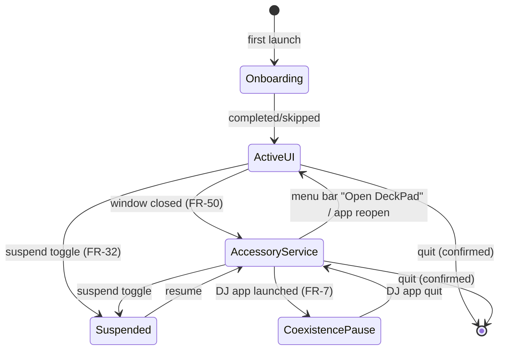

# DeckPad — Background Service & Lifecycle

How DeckPad becomes "sticky": launches at login, lives in the menu bar, survives unplugs and sleeps, and asks for permissions gracefully. Owned by **ServiceController** + **PermissionsManager** ([02-architecture.md](02-architecture.md)); single-app model per [ADR-001](99-decisions.md#adr-001-single-app-architecture).

## 1. Lifecycle state machine

Orthogonal to these states, device connectivity is `connected / disconnected` and gates the Dispatcher.

- **ActiveUI:** `NSApp.setActivationPolicy(.regular)` — Dock icon + full window.
- **AccessoryService:** `.accessory` — no Dock icon, menu-bar extra only, everything else running. Transition happens on last-main-window close; reopening (menu bar, Dock re-launch, `open -a DeckPad`) restores `.regular` (single-instance guard makes re-launch activate the running instance).
- **Suspended:** MIDI subscription stays alive (cheap), Dispatcher drops events, LEDs off, menu-bar icon shows paused. Instant resume.
- **Quit:** confirmation dialog when service is functional ("DeckPad stops responding to your controller when quit"), suppressible.

## 2. Launch at login (FR-51)

- `SMAppService.mainApp.register()` / `.unregister()` from Settings → General.
- Status surfaced from `SMAppService.status` (handles the user disabling it in System Settings → Login Items behind our back — Settings shows actual state, PermissionsManager publishes changes on app activation).
- On login-item launch: start straight into **AccessoryService** (no window) when onboarding is complete; otherwise show onboarding.

## 3. Device resilience (FR-4, NFR-3)

- MIDIEngine subscribes to MIDIKit's endpoint added/removed notifications — no polling.
- **Unplug:** state → disconnected; menu-bar dims; canvas shows empty state; nothing else torn down.
- **Replug:** endpoints matched by the FLX4 identity criteria ([03-device-ddj-flx4.md §1](03-device-ddj-flx4.md#1-device-facts)); subscription re-established; LED ambient state re-pushed; toast "DDJ-FLX4 connected" (respects feedback config).
- **Sleep/wake:** on wake, re-validate endpoint (CoreMIDI can renumber); re-push LED state. Display sleep alone: no action.
- **Fast user switching:** on session deactivation (`NSWorkspace.sessionDidResignActiveNotification`) suspend event injection (CGEvents must not leak into another user's session); resume on activation.

## 4. Permissions acquisition UX

Principles: ask **in context**, explain **what we never do**, verify **live**, never nag.

### Accessibility (the critical one)

1. Onboarding step 3 (or first action test without it): explanation card — "DeckPad needs Accessibility to press keys for you. It never reads your keyboard or screen."
2. Trigger the system prompt via `AXIsProcessTrustedWithOptions(prompt: true)` once; button "Open System Settings" deep-links `x-apple.systempreferences:com.apple.preference.security?Privacy_Accessibility`.
3. Poll `AXIsProcessTrusted()` at 1 Hz *only while the card/settings row is visible*; flip to success live.
4. **Runtime revocation:** ActionEngine failure sets PermissionsManager flag → menu-bar warning badge + one toast (not per keypress) + Settings → Permissions row turns red (FR-53). Recovery is the same deep link. Note for docs/support: after re-granting, macOS sometimes requires an app relaunch — the UI says so.

### Automation (AppleEvents)

- Requested lazily by macOS itself on first AppleScript action per target app. Before first run of an AppleScript mapping, inspector shows a hint ("macOS will ask to allow DeckPad to control <App>").
- Denials surface as action failure feedback + Permissions tab row with per-app status where determinable (`AEDeterminePermissionToAutomateTarget`).

### Login item

- System consent sheet appears on first `register()`; Settings row reflects `SMAppService.status` including `.requiresApproval`.

## 5. Coexistence with DJ software (FR-7)

The FLX4 is exclusive-ish in practice: rekordbox/djay/Serato take over MIDI and LED state; two hosts double-trigger.

- Watch `NSWorkspace.didLaunchApplicationNotification` / `didTerminateApplicationNotification` for known bundle IDs (rekordbox, djay Pro, Serato DJ Lite/Pro — list in settings, user-extensible).
- Default behavior **pause automatically**: enter CoexistencePause (Dispatcher off, LEDs released/off, menu-bar badge, optional toast). Auto-resume when the DJ app quits (LED ambient re-pushed).
- Alternative (Settings): keep running (user accepts double-triggering).

## 6. Single instance & CLI-adjacent behaviors

- Single-instance guard: on launch, if another DeckPad owns the MIDI session (checked via `NSRunningApplication` bundle-ID scan), activate it and terminate self.
- URL scheme `deckpad://` reserved (profile switch via `deckpad://profile/Xcode` considered post-v1 — noted, not committed).

## 7. Logging & diagnostics

- `os.Logger` subsystems: `midi`, `dispatch`, `action`, `feedback`, `service`, `store`. Signposts around input→injection for latency measurement (NFR-1 verification in M2).
- Settings → About: "Export diagnostics" gathers recent log archive + anonymized profile summary into a zip for bug reports.
- MIDI monitor doubles as the user-facing debug surface (FR-6).

## 8. Update & crash posture (v1)

- Updates: manual DMG download (NFR-4: no phone-home). Sparkle auto-update is a documented post-v1 candidate.
- Crash: no watchdog process in v1 (single-app tradeoff, ADR-001). Login item restores service on next login; abnormal-exit detection on next launch shows a gentle "DeckPad restarted" note and offers diagnostics export.
