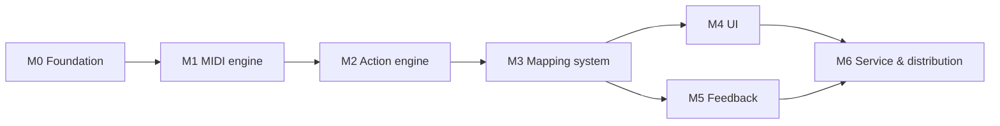

# DeckPad — Roadmap

Seven milestones, each with a demo criterion ("you can *see* it work"). Detailed checklists live in [tasks/](tasks/) — one file per milestone, checked off as work lands. Task files are the persistent to-do lists; never regenerate them, update them.

M4 and M5 can proceed in parallel once M3 lands.

| # | Milestone | Goal | Demo criterion | Task file |
|---|---|---|---|---|
| M0 | **Foundation** | Rename scaffold to DeckPad, sandbox off, SwiftData stripped, module skeleton + menu-bar shell | App builds & runs as "DeckPad", shows menu-bar icon, window ↔ accessory switch works | [tasks/M0-foundation.md](tasks/M0-foundation.md) |
| M1 | **MIDI engine** | Talk to the FLX4: discovery, hot-plug, decoded event stream, monitor UI; **capture the full device map** | Monitor window streams named ControlEvents while you play with the hardware; [03-device-ddj-flx4.md](03-device-ddj-flx4.md) tables fully populated (⏳ → ✅) | [tasks/M1-midi-engine.md](tasks/M1-midi-engine.md) |
| M2 | **Action engine** | Execute every action type in the catalog with permissions handled | A hardcoded test mapping: pad 1 types a keystroke, fader moves system volume, jog scrolls a webpage — measured < 50 ms | [tasks/M2-action-engine.md](tasks/M2-action-engine.md) |
| M3 | **Mapping system** | Real mappings: models, JSON store, trigger detection, profiles with per-app auto-switch, service lifecycle | Two profiles (Xcode + Global) auto-switch as you ⌘Tab; mappings survive relaunch; unplug/replug seamless | [tasks/M3-mapping-system.md](tasks/M3-mapping-system.md) |
| M4 | **UI** | The Liquid Glass app: canvas replica, mapping editor, ⌘K palette, sidebar, settings | Map a pad end-to-end using only the UI (click or MIDI-learn), watch live echo on the replica | [tasks/M4-ui.md](tasks/M4-ui.md) |
| M5 | **Feedback** | Notch toast, pill, sounds, LEDs — full config matrix | Trigger a pad: toast under the notch + pad LED flash; ride a fader: live pill bar; toggle each channel in Settings | [tasks/M5-feedback.md](tasks/M5-feedback.md) |
| M6 | **Service & distribution** | Login item, onboarding, notarized DMG | Fresh macOS user account: install DMG, onboard, reboot — controller works before any window opens | [tasks/M6-distribution.md](tasks/M6-distribution.md) |

## Working agreements

- A milestone is done when its task file's acceptance criteria are all checked — not when the code merely exists.
- Requirement IDs (FR/NFR) in task items link work back to [01-requirements.md](01-requirements.md).
- Discoveries that change a spec doc get edited into that doc in the same PR/commit as the code (docs stay true).
- New decisions → new ADR in [99-decisions.md](99-decisions.md).

## Post-v1 parking lot (not scheduled)

Ideas deliberately excluded from v1 (see also [01-requirements.md §4](01-requirements.md#4-explicit-non-goals-v1)): additional controller descriptors (DDJ-400/REV1), Sparkle auto-updates, Homebrew cask, macro sequences (`.sequence` action), `deckpad://` URL scheme, LED animations/VU meters, Stream Deck-style dynamic pad pages.
